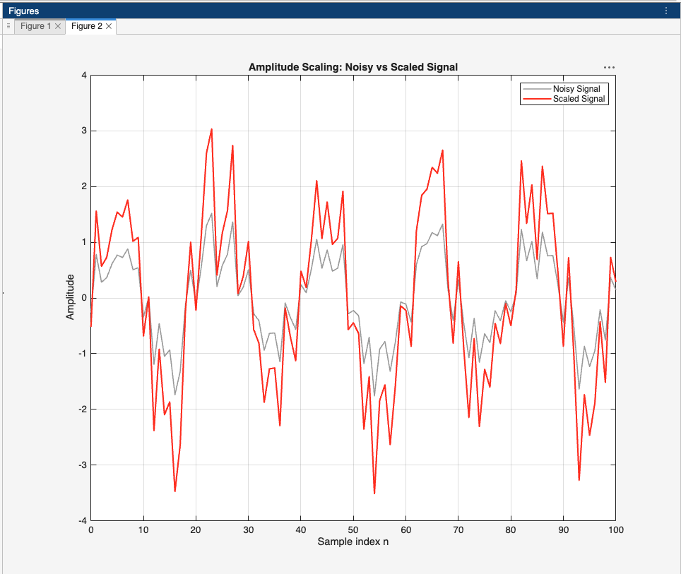
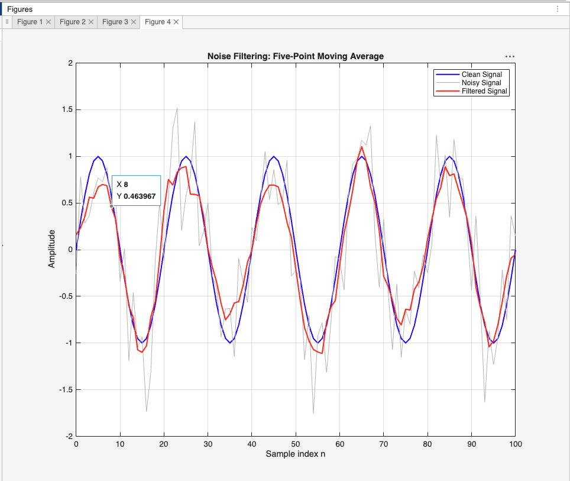
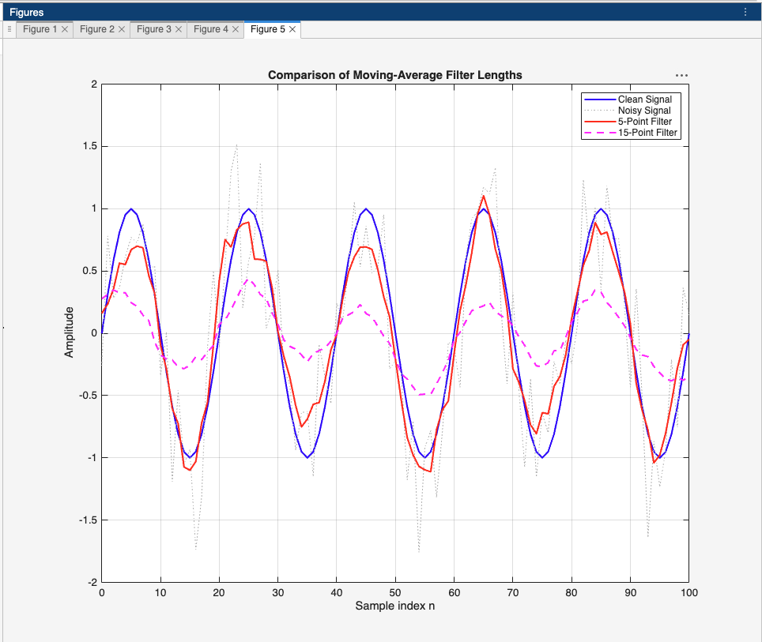

## Task1: Amplitude Scaling

### 1. What happened to the amplitude?
The amplitude of the noisy signal doubled because every sample value was multiplied by 2.

### 2. Did the signal frequency change?
No. Amplitude scaling does not change the signal frequency.

### 3. Did the sample positions change?
No. The sample positions remain the same, from \(n=0\) to \(n=100\). Only the amplitude values change.

## Task 2: Signal Delay

### 1. In which direction did the signal move?
The signal moved to the right by 5 samples because five zeros were added before the original signal.

### 2. Did the signal shape change?
No. The original signal shape remains unchanged, but its starting position is shifted by 5 samples.

### 3. What could cause a delay in a real system?
A delay can be caused by signal processing, data transmission, sensor response time, or the time required for a system to process a signal.

## Task 3: Five-Point Moving-Average Filter

## Task 4: Compare Two Filter Lengths

## Questions
**1. Which operation changed the signal amplitude?**

Amplitude scaling changed the signal amplitude. In Task 1, multiplying the noisy signal by 2 doubled the amplitude of every sample. The signal became taller, but its frequency and sample positions remained unchanged.

**2. How did the five-sample delay change the signal?**

The five-sample delay shifted the noisy signal five samples to the right. The delayed signal started with five zeros, followed by the original noisy signal. Its shape remained unchanged, but its position along the sample axis changed.

**3. What does the impulse response \(h[n]\) represent?**

The impulse response \(h[n]\) describes the behavior of a discrete-time system in response to a unit impulse. For the five-point moving-average filter, each of the five coefficients equals \(1/5\). These coefficients determine how the input samples are combined to produce each output sample.

**4. How did convolution change the noisy signal?**

Convolution with the five-point moving-average filter made the noisy signal smoother. In the MATLAB figure, the filtered signal fluctuated less than the original noisy signal and followed the clean sinusoidal signal more closely. This happened because averaging neighboring samples reduced rapid random variations.

**5. What differences did you observe between the 5-point and 15-point filters?**

The 15-point filter produced a smoother signal than the 5-point filter. However, it also reduced the peaks and troughs more noticeably and followed changes in the clean signal less accurately. The 5-point filter preserved more of the original signal's shape.

**6. Which filter removed more noise?**

The 15-point moving-average filter generally removed more noise because it averaged more neighboring samples. Random noise tended to cancel out during averaging, resulting in smaller fluctuations in the filtered signal.

**7. Did the longer filter remove or distort useful signal information?**

Yes. The 15-point filter reduced some useful signal information by attenuating the peaks and troughs of the sinusoidal signal. It also introduced more smoothing and could make rapid changes harder to observe. This occurred because averaging over a longer window suppressed variations in both the noise and the desired signal.

**8. Which filter would you recommend for this signal? Explain your decision.**

I would recommend the five-point moving-average filter for this signal. It reduced random noise while preserving the shape of the original sinusoidal signal relatively well. Although the 15-point filter provided stronger smoothing, it also caused greater attenuation of the signal's peaks and troughs. Therefore, the five-point filter offered a better balance between noise reduction and signal preservation.

**9. Give one real engineering application for moving-average filtering.**

One application is filtering temperature measurements from an IoT sensor. A moving-average filter can reduce random fluctuations in successive temperature readings, producing a more stable temperature estimate for monitoring and control systems.